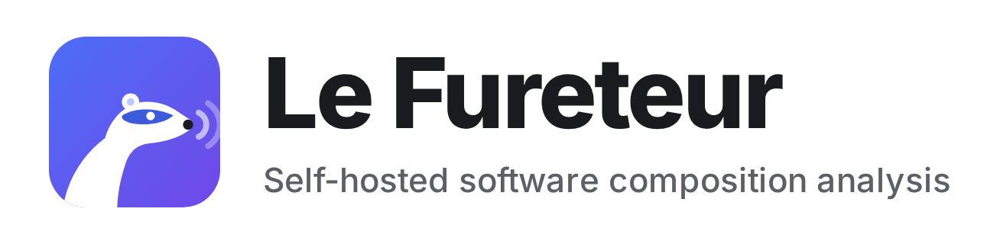
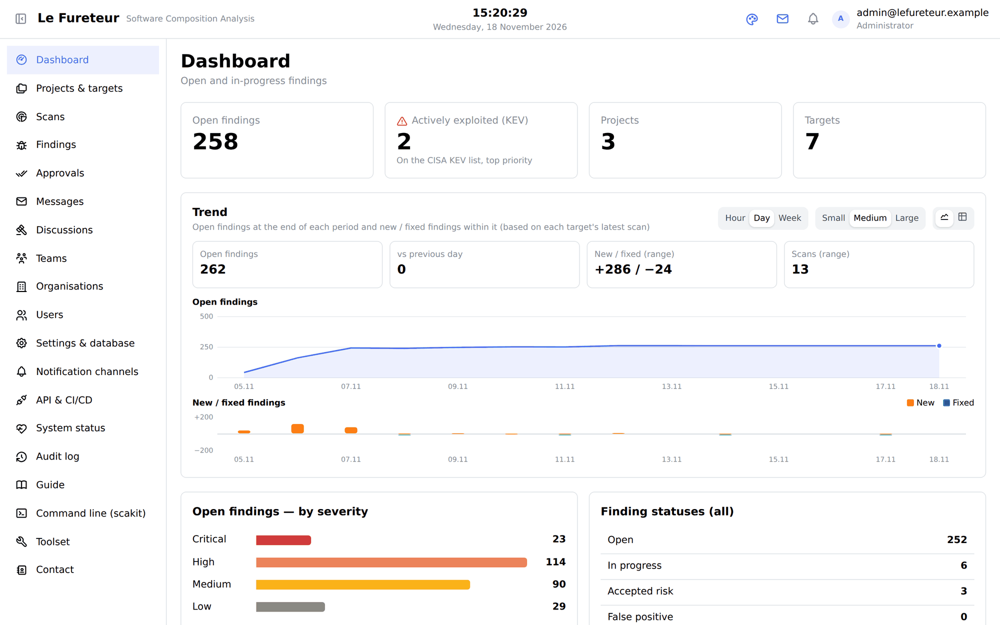
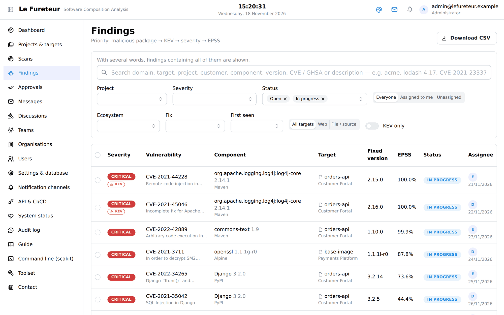
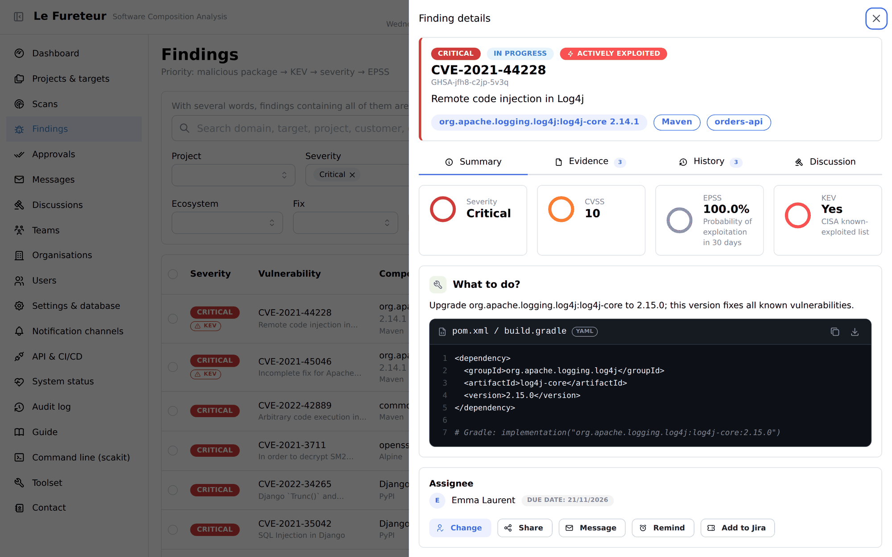
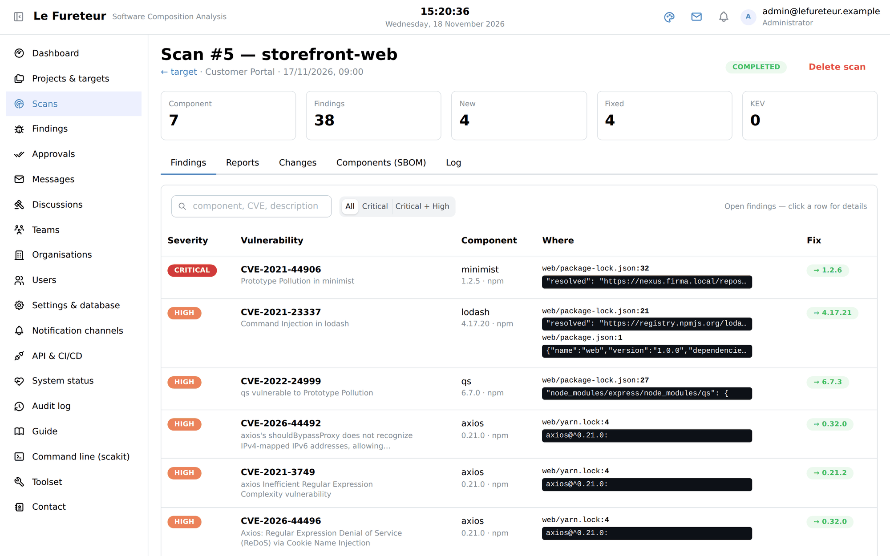
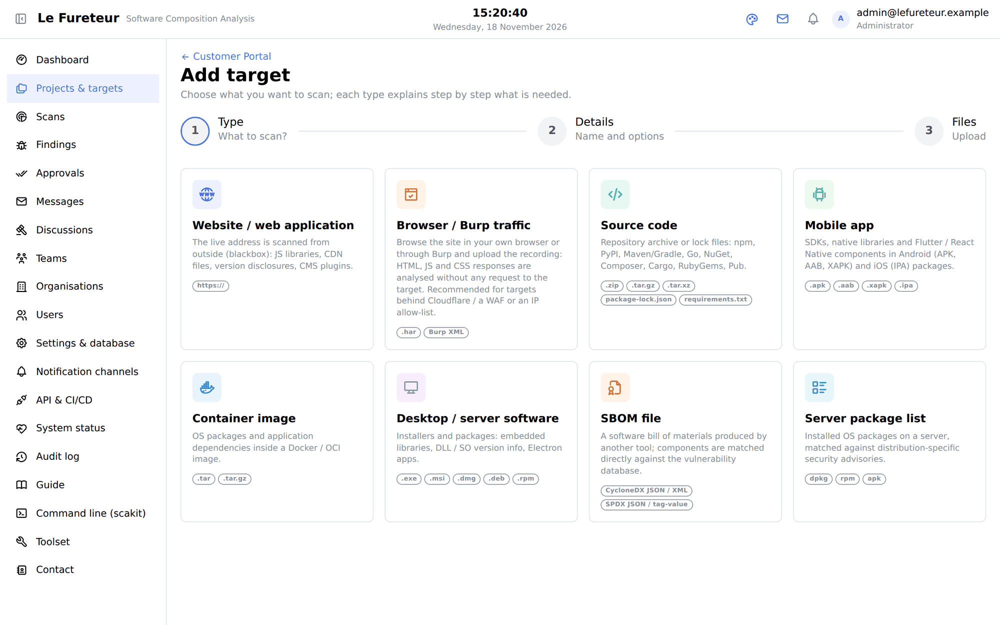
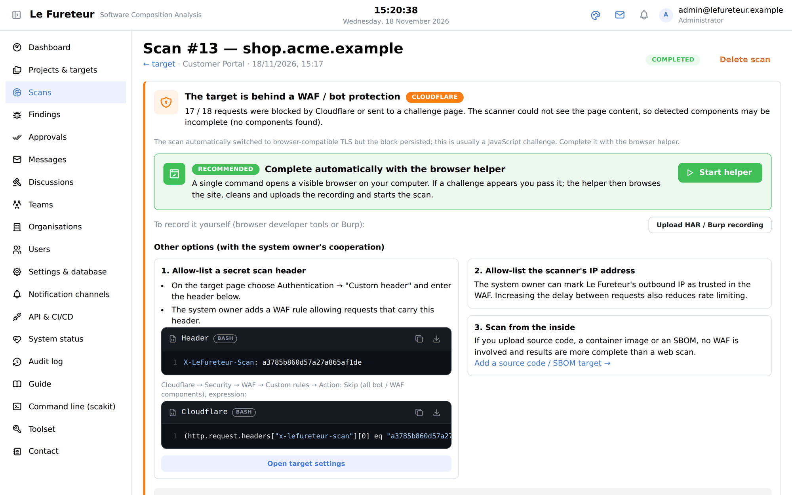
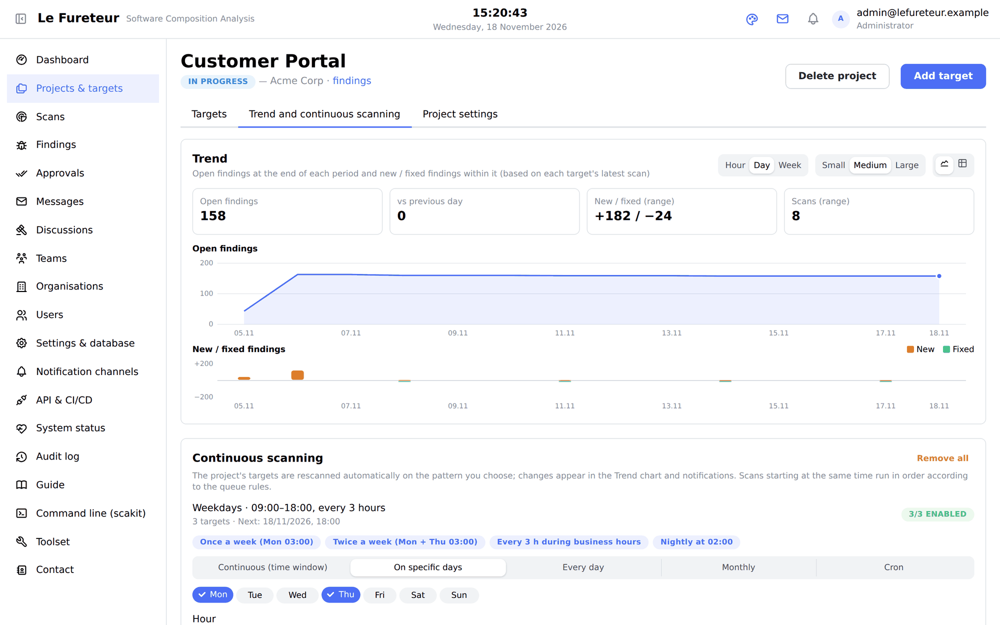
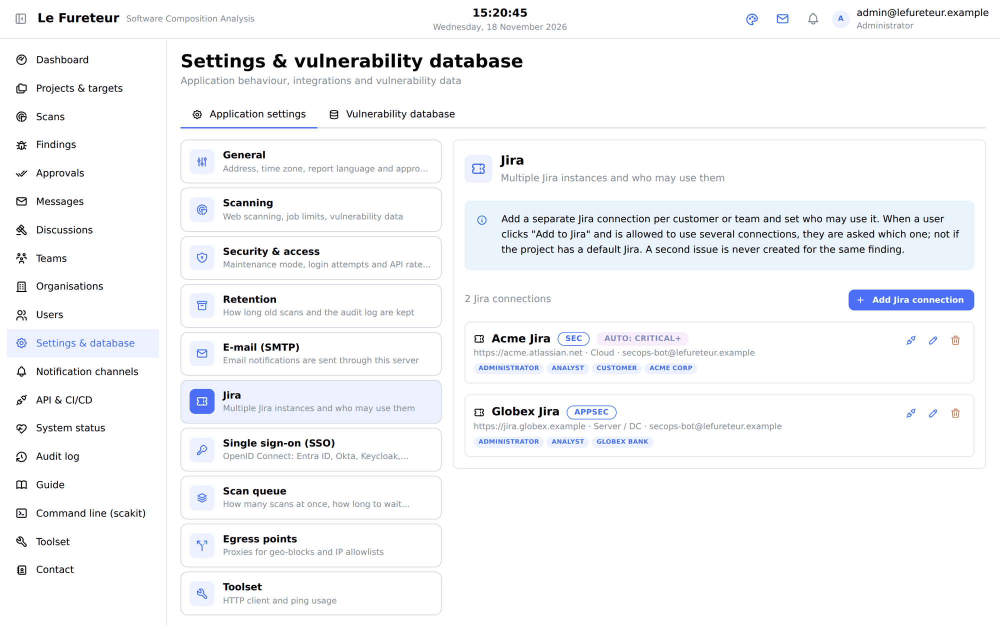

<p align="center">
  <picture>
    <source media="(prefers-color-scheme: dark)" srcset="docs/assets/banner-dark.png">
    
  </picture>
</p>

<p align="center">
  <strong>Find every third-party component in your software, see which ones are vulnerable,<br>and drive remediation from a single self-hosted web console.</strong>
</p>

<p align="center">
  <a href="LICENSE"></a>
  
  
  
</p>

<p align="center">
  <a href="#features">Features</a> ·
  <a href="#quick-start">Quick start</a> ·
  <a href="#vulnerability-data">Vulnerability data</a> ·
  <a href="#security">Security</a> ·
  <a href="#command-line-scakit">Command line</a> ·
  <a href="#license">License</a>
</p>

<p align="center">
  
</p>

## Why Le Fureteur

*Le fureteur* is French for "the one who rummages" — a ferret that sniffs into every corner. Le Fureteur looks inside source code, mobile apps, container images, installers and live websites, builds one inventory of the open-source components it finds and matches it against public vulnerability data.

- **Your code stays with you.** Le Fureteur runs on your own server. Analysis is offline; source code, binaries and findings never leave your network.
- **Whitebox and blackbox in one place.** Results from a repository, an APK and a production website land in the same inventory and the same prioritised list.
- **Built for teams.** Customers, projects, roles, assignments, approvals and an audit trail make it suitable for AppSec teams, security consultancies and pentesters alike.

## Features

### Prioritised findings

Every finding combines severity (CVSS), exploit probability (EPSS) and whether it is actively exploited (CISA KEV), so the list starts with what matters. Search across domains, targets, projects, customers, components and CVE / GHSA identifiers, filter by ecosystem or fix availability, and export to CSV.



### Actionable details

Each finding explains what to do: the fixed version, a ready-to-paste dependency snippet, the evidence and its history. Assign it with a due date, discuss it, request approval for a risk decision or push it to Jira.



### Evidence down to the file and line

Scan results show exactly where each component was found — file, line and the matching snippet — without downloading a report. Every scan keeps its reports, changes since the previous scan, the full component list (SBOM) and a log.



### Every kind of target

A guided wizard covers websites and web applications, browser or Burp recordings, source code and lock files, Android and iOS apps, container images, desktop and server installers, SBOM files and OS package lists. Add up to 50 web addresses at once.

| Target | What is analysed |
|---|---|
| Website / web application | JavaScript libraries, CDN files, source maps, version disclosures, CMS plugins |
| Source code | npm, PyPI, Maven / Gradle, Go, NuGet, Composer, Cargo, RubyGems, Pub, Swift |
| Mobile app | SDKs, native libraries, Flutter and React Native components in APK, AAB, XAPK and IPA |
| Container image | OS packages and application dependencies in Docker / OCI images |
| SBOM | CycloneDX (JSON / XML) and SPDX (JSON / tag-value) |
| Server packages | dpkg, rpm and apk package lists matched against distribution advisories |



### Works with protected websites

When a site is behind a WAF, a CAPTCHA, a geo-block or a login page, Le Fureteur tells you exactly what happened and how to continue: it switches to a browser-compatible client automatically, can route through approved egress proxies, and offers a browser helper that lets you pass a challenge yourself while the crawl and upload run on their own.



### Continuous scanning and trends

Schedule every target in a project at once — for example every three hours during business hours, or twice a week — and follow open, new and fixed findings by hour, day or week. Per-project queue rules decide whether scans run one by one, in parallel or with a pause between them.



### Integrations

- **Jira** — several Jira Cloud or Data Center connections, each restricted to chosen roles, users and customers; optional automatic issues for new critical findings.
- **Notifications** — Slack, Microsoft Teams, e-mail and signed webhooks.
- **Single sign-on** — OpenID Connect (Microsoft Entra ID, Okta, Keycloak, Google and others).
- **CI/CD** — ready-made templates for GitHub Actions, GitLab CI, Azure Pipelines and Jenkins with a policy gate and SARIF output.
- **REST API** — scoped API tokens for automation.



### Built for teams

- Organisations, projects and three roles (administrator, analyst, customer) with strict tenant isolation
- Assignments with due dates, approval workflow for risk decisions, discussions and direct messages
- Reports in HTML, PDF and Word, plus CycloneDX, SPDX and CSV exports — in English, French, German and Turkish
- Bulk actions with permission control, audit log, maintenance mode and system health checks
- Interface available in English, French, German and Turkish

## Quick start

Le Fureteur ships with a Docker Compose setup (web interface, background worker and PostgreSQL).

**Requirements:** Docker with Compose. Plan for about 5 GB of disk space for the vulnerability database; 2 CPU cores and 4 GB RAM are a comfortable starting point.

**1. Get the code and configure secrets**

```bash
git clone https://github.com/<your-account>/le-fureteur.git
cd le-fureteur/deploy
cp .env.example .env
```

Edit `.env` and replace both placeholder values with long random strings, for example with `openssl rand -base64 32`.

**2. Start the stack**

```bash
docker compose up -d --build
```

**3. Create the first administrator**

```bash
docker compose exec web scakit server init --email admin@example.com
```

**4. Open the web interface**

Go to **http://localhost:8800**, sign in, then open **Settings → Vulnerability database** and click **Update database** to download the vulnerability data (about 1 GB, refreshed automatically if you add a schedule).

> [!TIP]
> The interface listens on `127.0.0.1` by default. To reach it from other machines, set `SCAKIT_BIND=0.0.0.0` in `.env` and place a reverse proxy with TLS (nginx, Caddy, Traefik) in front of it; then set `SCAKIT_COOKIE_SECURE=1`.

## Vulnerability data

Matching runs against a local database built from public sources:

| Source | Used for |
|---|---|
| [OSV](https://osv.dev) | Package ecosystems and Linux distributions (Debian, Alpine, Red Hat, Rocky, AlmaLinux and more) |
| [NVD](https://nvd.nist.gov) | Server software and native libraries not covered by OSV |
| [EPSS](https://www.first.org/epss/) | Probability of exploitation in the next 30 days |
| [CISA KEV](https://www.cisa.gov/known-exploited-vulnerabilities-catalog) | Vulnerabilities known to be exploited in the wild |

**Air-gapped installations** — download the data on a machine with internet access, copy the folder to the server and import it from **Settings → Vulnerability database**. Step-by-step instructions are available in the application under **Command line (scakit)**.

## Security

- Offline analysis; only the vulnerability database download and the web targets themselves require network access
- Argon2 password hashing, CSRF protection, encrypted storage of integration secrets and rate limiting
- Server-side request forgery protection for outbound scan requests, re-checked on every redirect
- Uploaded archives and XML are processed with size limits and protection against path traversal and entity expansion
- Every significant action is recorded in the audit log

To report a vulnerability in Le Fureteur, please use **Security → Report a vulnerability** on this repository rather than a public issue. See [SECURITY.md](SECURITY.md).

## Command line (scakit)

The scanning engine is also available as a command-line tool, **scakit**, for air-gapped preparation, CI pipelines and serverless on-site assessments.

```bash
pip install ".[report]"
scakit db update
scakit init ./acme --name "Acme portal"
scakit add ./acme ./source.zip https://portal.acme.example
scakit match ./acme
scakit report ./acme --formats html,pdf,cdx
```

Run `scakit --help` for all commands, or open **Command line (scakit)** in the web interface for a complete guide.

## License

Le Fureteur is free software released under the [GNU Affero General Public License v3.0](LICENSE). If you modify it and offer it to others as a network service, you must make your modified source code available to them under the same license.
